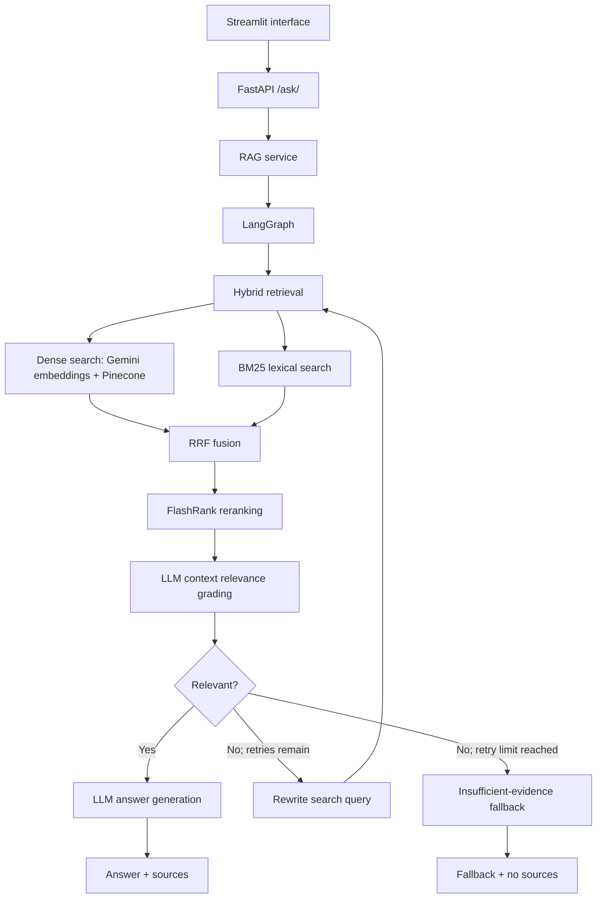

# Biomedical RAG — Production AI Engineering

A modular, production-oriented **retrieval-augmented generation (RAG)** application for question answering over biomedical and scientific PDF documents. The project focuses on controllable retrieval, evidence-grounded responses, adaptive workflows, and the engineering practices needed to evolve a research prototype into a deployable service.

> **Scope:** A biomedical literature assistant for research and technical exploration—not a clinical decision-support system. The project is developed and tested at portfolio scale; it is not represented as a validated large-scale production service.

## Key capabilities

- **PDF ingestion and chunking:** extract and split documents into retrievable passages.
- **Semantic retrieval:** Google Gemini embeddings and Pinecone vector search.
- **Lexical retrieval:** BM25 over ingested passages.
- **Hybrid ranking:** Reciprocal Rank Fusion (RRF) combines semantic and BM25 ranked results.
- **Reranking:** FlashRank selects a smaller, more relevant context for generation.
- **Adaptive RAG:** LangGraph grades retrieved context, rewrites weak search queries, retries retrieval once, and falls back when evidence remains insufficient.
- **Preserved intent:** the original user question stays separate from the retrieval-optimized search query.
- **API and interface:** FastAPI backend and Streamlit frontend; responses contain an answer and source document paths.
- **Evidence-aware fallback:** when the final relevance check fails, the API returns a fallback message with an empty source list.

## System architecture



The graph keeps `original_question` unchanged while `search_query` may be rewritten. `MAX_REWRITES = 1` bounds the retry loop, reducing the risk of repeated model calls and unbounded latency.

## Technology stack

| Area | Technology |
| --- | --- |
| Backend/API | Python, FastAPI |
| Web interface | Streamlit |
| Workflow orchestration | LangGraph, LangChain |
| Dense retrieval | Gemini embeddings, Pinecone |
| Lexical retrieval | `rank-bm25` |
| Rank fusion | Reciprocal Rank Fusion (RRF) |
| Reranking | FlashRank |
| LLM inference | Groq API (`openai/gpt-oss-120b` in the current configuration) |
| Engineering roadmap | RAG evaluation, automated tests, Docker, GitHub Actions, cloud deployment, observability |

## Getting started (local development)

**Prerequisites:** Python 3.11, access to the configured API providers, and a Pinecone index compatible with the application's embedding dimensionality. The current implementation uses 768-dimensional Gemini embeddings.

1. Clone the repository and enter the backend directory:

   ```bash
   git clone <YOUR_REPOSITORY_URL>
   cd <YOUR_REPOSITORY_NAME>/server
   python3.11 -m venv .venv
   source .venv/bin/activate
   python -m pip install -r requirements.txt
   ```

2. Set environment variables in a local `.env` file (never commit it):

   ```dotenv
   GROQ_API_KEY=your_groq_api_key
   PINECONE_API_KEY=your_pinecone_api_key
   PINECONE_INDEX_NAME=medicalindex
   GOOGLE_API_KEY=your_google_api_key
   ```

   Check the code and provider configuration for any additional required settings.

3. Start the API from the `server` directory:

   ```bash
   uvicorn main:app --reload
   ```

4. In a second terminal, test the question-answering endpoint **after uploading/indexing documents**:

   ```bash
   curl -X POST http://127.0.0.1:8000/ask/ \
     -F "question=What are neurons?"
   ```

5. To run the Streamlit interface, install dependencies in `client/requirements.txt` and launch `client/app.py`, configuring the API base URL as required by `client/config.py`:

   ```bash
   cd ../client
   python -m pip install -r requirements.txt
   streamlit run app.py
   ```

**Note:** Local BM25 retrieval depends on the chunk data generated by the PDF ingestion flow (`server/bm25_chunks.json`). Run ingestion before asking questions. The upload API/interface is available in the project; its precise route and usage should be checked against the current source code.

## Verified behavior

The following scenarios were exercised during the LangGraph V3 development:

- A biomedical question such as **“What are neurons?”** returned a generated answer and sources through the FastAPI endpoint.
- An out-of-domain question such as **“What is the capital of France?”** triggered query rewriting and one retry, then produced the insufficient-evidence fallback.
- The final state retained the original question and changed the search query from `What is the capital of France?` to `What is the capital city of France?`.
- The fallback API response returned `"sources": []` rather than citing rejected passages.

These are functional checks, **not** benchmark results or guarantees of hallucination prevention.

## Engineering roadmap

| Stage | Focus |
| --- | --- |
| V1 | Modular refactoring of retrieval, service, and API boundaries |
| V2 | Hybrid dense/BM25 retrieval, RRF, and reranking |
| V3 | LangGraph relevance grading, query rewriting, retry, and fallback |
| V4 | Systematic RAG evaluation |
| V5 | Automated tests |
| V6 | Docker/containerization |
| V7 | GitHub Actions CI/CD |
| V8 | Personal Azure deployment |
| V9 | Observability and operational improvements |

**Deployment direction (V8):** Azure Container Apps Consumption, preferably scale-to-zero, with external model APIs rather than dedicated GPUs. Target combined operating cost is approximately **€10–€30/month**, including external services; this is a budget target, not a measured or guaranteed cost. Azure budget alerts are notifications, not hard caps, and external provider spending must be tracked separately.

## Design decisions and limitations

This project intentionally implements retrieval and workflow orchestration at the application level so that dense search, BM25, fusion, reranking, grading, and query rewriting can be inspected and evaluated independently. Managed RAG offerings could reduce operational effort in other settings; the appropriate choice depends on customization, security, cost, latency, scale, and an organization's existing cloud environment.

The current local BM25 index uses a JSON-backed collection and is suited to development and experimentation, not large concurrent ingestion workloads. Other production considerations include authentication, secret management, secure CORS policies, ingestion concurrency, rate limits, caching, quantitative evaluation, deployment hardening, and monitoring. These should be validated as features are added rather than assumed complete.

## Security and responsible use

- Do not commit `.env` files, API keys, personal notes, virtual environments, or private/third-party PDFs.
- Do not upload sensitive patient records without an appropriate security, privacy, and compliance assessment.
- Responses are grounded in retrieved text where possible, but model output may still be incomplete or incorrect. Verify claims against original sources.
- This application is intended for research and education, not medical diagnosis or treatment decisions.

## Origin, authorship, and license


**Current project development and extensions:** Arezoo Alizadeh.

